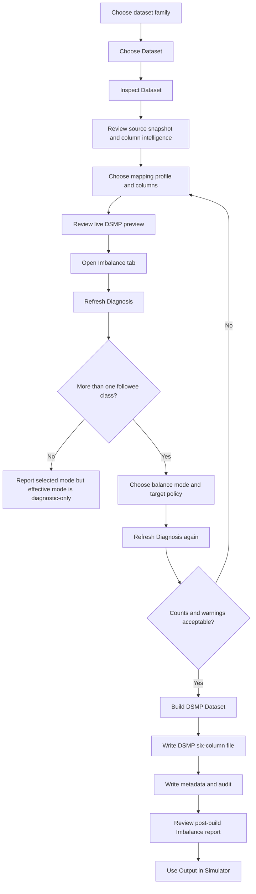
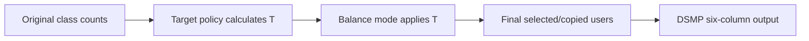
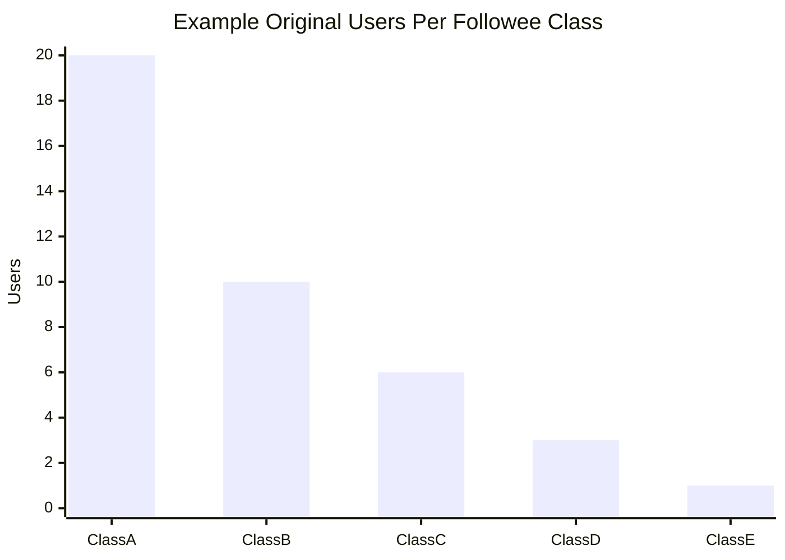

# DSMP Data Preprocessing and Imbalance Balancing Guide

Audience: testers, students, reviewers, and instructors validating DSMP dataset import, augmentation, and class balancing.

Status: applies to the current DSMP Data Preprocessing Lab and the older v2.6 Dataset Import Lab after the imbalance feature was ported.

## 1. Purpose

The Data Preprocessing Lab converts source datasets into the six-column DSMP text format used by the simulator. The imbalance feature adds a controlled, audited way to diagnose and optionally balance class distributions before the DSMP file is written.

This guide explains:

- what the preprocessing page does,
- what the imbalance section means,
- how each button and setting should be used,
- what happens before and after `Build DSMP Dataset`,
- how every balance mode and target policy behaves,
- how testers should verify correct behavior,
- what warnings and edge cases mean.

The most important idea is this:

DSMP balancing is user-level followee-class balancing. The class is the final followee/reference label, and the instance is a DSMP user document. Raw rows are evidence for users. This is why the balancer works with users per followee class, not only raw row counts.

## 2. Quick Start for Testers

Use this path for a normal validation run:

1. Open `Data Preprocessing Lab` in the current UI, or `Dataset Import Lab` in the v2.6 UI.
2. Choose the dataset family:
   - `Retail`
   - `Journal`
   - `Tweets`
   - `Other`
3. Click `Choose Dataset`.
4. Select the source file.
5. Click `Inspect Dataset`.
6. Review the mapping profile and detected columns.
7. Keep `Keep one stable followee label per user` checked for classifier-style tests.
8. Open the `Imbalance` tab.
9. Click `Refresh Diagnosis`.
10. Choose a balance mode and target policy.
11. Click `Refresh Diagnosis` again.
12. If the diagnosis looks correct, click `Build DSMP Dataset`.
13. Review the post-build imbalance report, metadata file, and audit file.
14. Click `Use Output in Simulator` only after the DSMP output looks correct.

Recommended normal setting for a balanced exported artifact:

- `Balance mode`: `Weka supervised Resample`
- `Target policy`: `Auto: preserve total size`
- `Balance seed`: `1`, unless testing reproducibility with another seed
- `Manual target users/class`: leave at `0`, unless `Target policy` is `Manual target`

Recommended conservative no-synthetic setting:

- `Balance mode`: `Conservative majority cap`
- `Target policy`: `Auto: conservative cap`

Recommended first step before changing output:

- `Balance mode`: `Diagnose only`
- then click `Refresh Diagnosis`

## 3. What the Preprocessing Page Produces

Every successful build writes a DSMP text file with exactly six tab-separated columns:

| DSMP column | Meaning |
|---|---|
| 1. Followee | The class/reference/target label used by DSMP. |
| 2. Post id | Numeric post/record id. Generated if missing. |
| 3. Date | Normalized date. Uses fallback if needed. |
| 4. User id | Numeric user/entity/customer/author id. |
| 5. User name | User display name. Generated if missing. |
| 6. Text | Document body used by similarity, Doc2Vec, SVM, MLP, and other text-based processing. |

The output contract does not change when balancing is enabled. The simulator still receives the same six-column format.

## 4. Where the Feature Appears

### Current UI

Open the top navigation item:

`Data Preprocessing Lab`

The page contains:

- source selection,
- mapping profile,
- detected columns,
- custom mapping,
- `Class Balance`,
- validation and output,
- build/use controls,
- tabs:
  - `Source Snapshot`
  - `Column Intelligence`
  - `DSMP Output Preview`
  - `Imbalance`

### v2.6 Old UI

Open:

`Dataset Import Lab`

The old UI has the same feature in the older Swing layout:

- section `5. Class Balance`,
- tab `Imbalance`,
- button `Refresh Diagnosis`.

The labels are intentionally similar so testers can use the same guide for both versions.

## 4.1 UI Map

Use this schematic to orient testers before they begin.

```text
Data Preprocessing / Dataset Import Lab

Left workflow column
  1. Dataset Family and File
     - Dataset family
     - Choose Dataset
     - Inspect Dataset

  2. Mapping Profile
     - Followee meaning
     - Keep one stable followee label per user

  3. Detected Source Columns
     - Invoice/order id
     - Stock/product code
     - Description/text
     - Quantity
     - Date
     - Unit price
     - Customer/user id
     - Country/reference

  4. Custom DSMP Column Mapping
     - Used when profile is Custom

  5. Class Balance
     - Balance mode
     - Target policy
     - Manual target users/class
     - Balance seed

  6. Validation and Output
     - Validation filters
     - Output folder
     - Output dataset name

  7. Build and Use
     - Build DSMP Dataset
     - Use Output in Simulator
     - Reset Defaults

Center tabs
  - Source Snapshot
  - Column Intelligence
  - DSMP Output Preview
  - Imbalance

Right/report area
  - Live DSMP Snapshot
  - Import Console
```

## 5. End-to-End Workflow Diagram

If this Markdown viewer supports Mermaid, the diagram below will render visually.



## 6. Key Concepts

### 6.1 Followee Class

The followee/reference label is the class label for classifier-style experiments. Examples:

- Retail smart product category: `HomeDecor`, `KitchenDining`, `BagsAccessories`
- Journal venue: journal or conference name
- Tweets: referenced/source account
- Custom: selected followee/reference column

### 6.2 User Instance

DSMP aggregates rows into user documents. For balancing, a user is the unit of class support.

This is why the imbalance table shows `Original users` and `Final users`, not only rows.

### 6.3 Rows as Evidence

Rows are the text evidence belonging to a user. If a user is selected, that user's rows are written. If a user is dropped, that user's rows are skipped. If a user is copied by an oversampling mode, deterministic synthetic DSMP user/post ids are written so the output remains valid.

### 6.4 Stable Followee Per User

The checkbox `Keep one stable followee label per user` should normally stay checked for class balancing and classifier tests.

When it is checked:

- each user gets one dominant followee label,
- the class distribution is user-level and stable,
- SVM/MLP-style labels are more meaningful.

When it is unchecked:

- a user's rows may retain different row-level followee labels,
- balancing is harder to interpret,
- this should be reserved for advanced custom import tests.

### 6.5 Selected Mode vs Effective Mode

The UI reports both when needed:

- `Selected mode`: what the tester selected in the dropdown.
- `Effective mode`: what the importer could actually apply.

Example:

If `Weka SpreadSubsample` is selected but the current mapping produces only one followee class, balancing is not meaningful. The report will show:

- `Selected mode: Weka SpreadSubsample`
- `Effective mode: Diagnose only`
- `Engine: not applied: only one followee class`

This is correct. It means the UI did not ignore the selected mode; the dataset shape made balancing impossible.

## 7. The Class Balance Section

The `Class Balance` section has four controls:

| Control | Purpose |
|---|---|
| `Balance mode` | Chooses the balancing engine/action. |
| `Target policy` | Chooses how the target users/class number is calculated. |
| `Manual target users/class` | Used only when `Target policy` is `Manual target`. |
| `Balance seed` | Makes sampling repeatable. Same seed plus same settings should produce the same plan. |

Changing any of these settings marks the Imbalance report as stale. Click `Refresh Diagnosis` to update the numbers.

## 8. Imbalance Tab

The `Imbalance` tab is the main testing surface for this feature.

### 8.1 Before Build

After `Inspect Dataset`, click:

`Refresh Diagnosis`

This scans the full accepted dataset with the current mapping and balance settings. It does not write the DSMP output file.

The pre-build report answers:

- How many classes exist?
- How many users are in each class?
- How imbalanced are the classes?
- What would the selected balancing mode do?
- How many users would be dropped?
- How many synthetic user instances would be created?
- Is the current mapping meaningful for classifier balancing?

### 8.2 After Build

After `Build DSMP Dataset`, the tab becomes a post-build report. It shows the exact output that was written.

The post-build report answers:

- What mode was selected?
- What effective mode was applied?
- Which engine ran?
- What target policy was used?
- How many users were originally available?
- How many original users were selected?
- How many original users were dropped?
- How many synthetic user instances were created?
- How many rows were dropped?
- What are the final class counts?

## 9. Imbalance Table Columns

| Column | Meaning | What testers should check |
|---|---|---|
| `Followee` | Class label. | Should match the intended mapping profile. |
| `Original users` | Unique users before balancing. | This is the main class support count. |
| `Original rows` | Rows/text evidence before balancing. | Helps identify large user/document classes. |
| `Final users` | User instances after the selected balancing mode. | Should match the expected mode behavior. |
| `User share` | Percent of original users in that class. | Large spread indicates imbalance. |
| `Ratio` | Original users divided by smallest class. | Higher ratio means stronger imbalance. |
| `Balance action` | What happened to the class. | Should explain dropped, augmented, unchanged, or not applied. |

## 10. Target Policies

Target policy is separate from balance mode. This is intentional.

The target policy calculates a target number `T`. The balance mode then decides how to use `T`.

Let:

- `count(label)` = original unique users in a followee class,
- `min` = smallest class size,
- `q25` = 25th percentile class size,
- `q75` = 75th percentile class size,
- `median` = median class size,
- `avg` = total users divided by number of classes.

| Target policy | Formula | Best use |
|---|---|---|
| `Auto: preserve total size` | `T = round(avg)` | Best with `Weka supervised Resample` for a balanced exported artifact. |
| `Auto: conservative cap` | `T = q75` | Best no-synthetic cap for majority classes. |
| `Auto: strict minority` | `T = min` | Exact downsampling to smallest class. |
| `Auto: bounded augmentation` | `T = min(median, max(q25, min * 8))` | Hybrid mode when small classes need support but synthetic growth must be bounded. |
| `Manual target` | `T = user-entered number` | Controlled experiments and demonstrations. |

Manual target note:

If `Manual target` is selected and the number is `0`, the importer falls back to the mode-recommended policy and warns. If strict/downsampling-only modes receive a manual target above the smallest class, they cap it to the smallest class and warn.

## 11. Balance Modes

### 11.1 Off

Behavior:

- writes every accepted DSMP row,
- does not change class counts,
- target policy is effectively ignored.

Use when:

- testing the importer only,
- comparing unbalanced vs balanced outputs,
- preserving the original source distribution.

Expected report:

- `Engine: none`
- final users match original users.

### 11.2 Diagnose only

Behavior:

- scans the full accepted dataset,
- reports imbalance,
- does not modify output.

Use when:

- first inspecting a dataset,
- explaining imbalance to students,
- checking whether balancing is needed.

Expected report:

- `Engine: diagnostic-only`
- final users match original users.

### 11.3 Conservative majority cap

Behavior:

- uses the DSMP-native balancer,
- keeps all classes below or equal to target,
- down-samples only classes above target,
- never creates synthetic users.

Formula per class:

`final(label) = min(count(label), T)`

Use when:

- avoiding synthetic data is important,
- majority classes are too large,
- a conservative research/demo artifact is needed.

Best target policy:

- `Auto: conservative cap`

Expected report:

- majority classes show `Downsampled ... original users`,
- minority classes show unchanged final users,
- `Synthetic users` should be `0`.

### 11.4 Strict user-level balance

Behavior:

- uses the DSMP-native balancer,
- down-samples every class to the same target,
- cannot create users,
- target is capped to the smallest class if needed.

Formula per class:

`final(label) = min(count(label), T)`

But if `T > min`, then `T` is capped to `min`.

Use when:

- demonstrating exact balance,
- creating a small strict classroom example,
- comparing algorithms under perfectly equal class support.

Best target policy:

- `Auto: strict minority`

Warning:

This can discard a lot of data when one class is very small.

### 11.5 Hybrid cap + augmentation

Behavior:

- uses the DSMP-native balancer,
- down-samples classes above target,
- augments classes below target by creating deterministic synthetic DSMP user instances,
- writes valid six-column rows for each synthetic instance.

Formula per class:

- if `count(label) > T`, downsample to `T`,
- if `count(label) < T`, copy selected users until the class reaches `T`,
- if `count(label) = T`, keep unchanged.

Use when:

- minority classes need support,
- exact or near-exact output balance is useful,
- testers need a visible before/after balancing demonstration.

Best target policy:

- `Auto: bounded augmentation`

Audit expectation:

- synthetic users must be reported,
- dropped users must be reported,
- final followee user counts must be reported.

### 11.6 Weka SpreadSubsample

Behavior:

- builds a lightweight Weka table with one instance per DSMP user/class,
- uses `weka.filters.supervised.instance.SpreadSubsample`,
- down-samples toward uniform class distribution,
- does not invent users,
- target is capped to the smallest class when needed.

Use when:

- the tester specifically wants Weka-backed downsampling,
- exact uniform downsampling is desired,
- synthetic users should be avoided.

Best target policy:

- `Auto: strict minority`

Expected report:

- `Engine: weka.filters.supervised.instance.SpreadSubsample`
- synthetic users should be `0`.

### 11.7 Weka supervised Resample

Behavior:

- builds a lightweight Weka table with one instance per DSMP user/class,
- uses `weka.filters.supervised.instance.Resample`,
- sets uniform class bias,
- controls Weka sample size from the target users/class,
- may sample with replacement,
- duplicate Weka-selected users are written as deterministic synthetic DSMP user instances.

Use when:

- creating a balanced exported artifact,
- preserving approximate total dataset size is important,
- the professor/tester wants Weka-supported resampling.

Best target policy:

- `Auto: preserve total size`

Expected report:

- `Engine: weka.filters.supervised.instance.Resample`
- final class counts should be more uniform,
- synthetic users may be greater than `0`,
- dropped users may be greater than `0`.

## 12. How Modes and Target Policies Combine

Think of the feature in two layers:



The target policy answers:

What target size should we aim for?

The balance mode answers:

What are we allowed to do to reach that target?

### 12.1 Combination Matrix

| Balance mode | Preserve total size | Conservative cap | Strict minority | Bounded augmentation | Manual target |
|---|---|---|---|---|---|
| `Off` | Ignored; unchanged. | Ignored; unchanged. | Ignored; unchanged. | Ignored; unchanged. | Ignored; unchanged. |
| `Diagnose only` | Diagnoses only; unchanged. | Diagnoses only; unchanged. | Diagnoses only; unchanged. | Diagnoses only; unchanged. | Diagnoses only; unchanged. |
| `Conservative majority cap` | Caps classes above average. | Caps classes above 75th percentile. | Caps all classes to smallest class. | Caps classes above bounded target. | Caps classes above manual target. |
| `Strict user-level balance` | Capped to smallest class if above it. | Capped to smallest class if above it. | Exact smallest-class downsampling. | Capped to smallest class if above it. | Exact manual target if <= smallest class; otherwise capped. |
| `Hybrid cap + augmentation` | Downsample/augment toward average. | Downsample/augment toward 75th percentile. | Downsample to smallest class; no class needs augmentation. | Downsample/augment toward bounded target. | Downsample/augment toward manual target. |
| `Weka SpreadSubsample` | Capped to smallest class if above it. | Capped to smallest class if above it. | Weka downsampling to smallest class. | Capped to smallest class if above it. | Weka downsampling to manual target if <= smallest class; otherwise capped. |
| `Weka supervised Resample` | Weka resampling toward average class size. | Weka resampling toward 75th percentile target. | Weka resampling toward smallest class target. | Weka resampling toward bounded target. | Weka resampling toward manual target. |

## 13. Worked Example

Assume the accepted dataset has five followee classes:

| Class | Original users |
|---|---:|
| ClassA | 20 |
| ClassB | 10 |
| ClassC | 6 |
| ClassD | 3 |
| ClassE | 1 |

Derived target policies:

| Target policy | Target users/class |
|---|---:|
| `Auto: strict minority` | 1 |
| `Auto: conservative cap` | 10 |
| `Auto: bounded augmentation` | 6 |
| `Auto: preserve total size` | 8 |

Expected examples:

- `Strict user-level balance` + `Auto: strict minority` gives 1 user/class.
- `Conservative majority cap` + `Auto: conservative cap` caps ClassA from 20 to 10 and leaves smaller classes unchanged.
- `Hybrid cap + augmentation` + `Auto: bounded augmentation` moves all classes toward 6 users/class by downsampling ClassA/ClassB and augmenting ClassD/ClassE.
- `Weka supervised Resample` + `Auto: preserve total size` targets about 8 users/class while keeping total size approximately similar.

Visual example:



## 14. Retail Dataset Guidance

For UCI Online Retail, mapping choice matters.

### Similar users / entities

This profile creates one shared followee label, usually `OnlineRetail`.

Result:

- only one class,
- no meaningful class imbalance,
- balancing cannot be applied,
- report should show selected mode and effective diagnostic-only behavior.

Use this profile for:

- user similarity,
- Doc2Vec,
- K-Means,
- workflows where one collection label is intentional.

Do not use it to demonstrate SVM/MLP class balancing.

### Retail: smart product category

This profile assigns customers to dominant retail categories.

Use this profile for:

- classifier-style class labels,
- imbalance demonstrations,
- SVM/MLP target experiments,
- meaningful followee-class balancing.

### Country baseline

This profile uses country/region as the followee label.

Use this profile for:

- sanity checks,
- simple multi-class examples,
- explaining how mapping creates classes.

### Stock code experimental

This profile can create many classes.

Use carefully because:

- high cardinality can create tiny classes,
- SVM/MLP can become heavy,
- imbalance ratios can become extreme.

## 15. What Happens Internally

### 15.1 Inspect Dataset

When `Inspect Dataset` runs:

1. The file format is detected.
2. Headers and delimiters are inspected.
3. Source row count is estimated.
4. Column profiles are built.
5. Sample rows are loaded.
6. Safe default column mappings are chosen.
7. The live DSMP preview updates.
8. The Imbalance tab can run a full diagnosis.

No DSMP output file is written during inspection.

### 15.2 Refresh Diagnosis

When `Refresh Diagnosis` runs:

1. Current mapping and validation settings are collected.
2. The full accepted dataset is scanned.
3. Each accepted row is mapped to DSMP shape.
4. Each user receives a final/dominant followee class.
5. Original users and rows per class are counted.
6. The selected balance mode and target policy are simulated.
7. The final user counts, dropped users, synthetic users, and warnings are displayed.

No DSMP output file is written during diagnosis.

### 15.3 Build DSMP Dataset

When `Build DSMP Dataset` runs:

1. Pass 1 validates rows and computes stable followee labels.
2. The balance plan is created from users per followee class.
3. Pass 2 writes the DSMP six-column output.
4. Dropped users' rows are skipped.
5. Copied users are written with deterministic synthetic DSMP ids.
6. Metadata is written.
7. Audit file is written.
8. The Imbalance tab updates with exact post-build counts.

### 15.4 Metadata and Audit

The metadata and audit record:

- selected balance mode,
- effective balance mode,
- balance engine,
- target policy,
- target users/class,
- target source,
- seed,
- original users,
- selected original users,
- dropped users,
- synthetic users,
- dropped rows,
- original followee user counts,
- original followee row counts,
- final followee user counts,
- final followee row counts.

## 16. Why Weka Is Used This Way

Weka is included and used for:

- `weka.filters.supervised.instance.SpreadSubsample`
- `weka.filters.supervised.instance.Resample`

The implementation does not rely only on Weka because Weka does not understand the full DSMP six-column semantics. DSMP must still control:

- stable followee-per-user mapping,
- user-level balancing,
- synthetic DSMP user/post ids,
- six-column output validity,
- metadata/audit reporting,
- one-class mapping warnings.

### Why not only Weka ClassBalancer?

Weka `ClassBalancer` changes instance weights. DSMP's exported preprocessing artifact is a text file, and downstream DSMP components do not consistently consume Weka instance weights from that file. Therefore, row/user selection and audited output changes are more appropriate for this page.

### Why not make SMOTE the main answer?

Classic SMOTE creates synthetic numeric feature vectors. DSMP's preprocessing artifact is real six-column text/user data. Synthetic TF-IDF-like vectors do not map cleanly back to real DSMP users/text rows. SMOTE can be an advanced future experiment, but it is not the safest core preprocessing feature.

## 17. Recommended Recipes

### 17.1 First-time dataset review

Use:

- `Balance mode`: `Diagnose only`
- `Target policy`: any auto policy is fine because output is unchanged
- click `Refresh Diagnosis`

Goal:

- understand class distribution before changing data.

### 17.2 Best Weka-backed balanced artifact

Use:

- `Balance mode`: `Weka supervised Resample`
- `Target policy`: `Auto: preserve total size`
- `Balance seed`: `1`

Goal:

- balanced exported DSMP file,
- approximate total size preservation,
- Weka-supported resampling.

### 17.3 Safest no-synthetic research artifact

Use:

- `Balance mode`: `Conservative majority cap`
- `Target policy`: `Auto: conservative cap`

Goal:

- reduce majority dominance,
- avoid synthetic users,
- keep minority classes untouched.

### 17.4 Exact balanced classroom demo

Use:

- `Balance mode`: `Strict user-level balance`
- `Target policy`: `Auto: strict minority`

Goal:

- exact same users/class,
- simple to explain,
- can discard many majority users.

### 17.5 Minority-support demo

Use:

- `Balance mode`: `Hybrid cap + augmentation`
- `Target policy`: `Auto: bounded augmentation`

Goal:

- show both downsampling and augmentation,
- avoid explosive growth from tiny minority classes.

## 18. Tester Checklist

### 18.1 Smoke Test

1. Open the lab.
2. Choose a small CSV.
3. Click `Inspect Dataset`.
4. Confirm the tabs populate.
5. Open `Imbalance`.
6. Click `Refresh Diagnosis`.
7. Confirm a pre-build report appears.
8. Click `Build DSMP Dataset`.
9. Confirm output path, metadata path, and audit path appear.
10. Confirm the post-build imbalance report appears.

Pass criteria:

- no crash,
- table rows appear,
- summary includes selected mode and engine,
- output remains six-column DSMP.

### 18.2 One-Class Mapping Test

Use retail with `Similar users / entities`.

Expected:

- one followee class, usually `OnlineRetail`,
- balancing is not meaningful,
- if a balancing mode is selected, report shows:
  - selected mode as chosen,
  - effective mode as `Diagnose only`,
  - engine explaining only one followee class,
  - final users unchanged.

Pass criteria:

- UI does not look stale,
- selected and effective mode are both visible,
- warning explains the issue.

### 18.3 Multi-Class Mapping Test

Use retail with `Retail: smart product category`.

Expected:

- multiple followee classes,
- imbalance ratios appear,
- mode and policy change final user counts in diagnosis.

Pass criteria:

- changing `Balance mode` marks report stale,
- `Refresh Diagnosis` updates final users,
- `Build DSMP Dataset` matches diagnosis closely or exactly depending on Weka sampling.

### 18.4 Conservative Cap Test

Use:

- `Balance mode`: `Conservative majority cap`
- `Target policy`: `Auto: conservative cap`

Expected:

- oversized classes downsample,
- minority classes unchanged,
- synthetic users = 0.

### 18.5 Hybrid Test

Use:

- `Balance mode`: `Hybrid cap + augmentation`
- `Target policy`: `Auto: bounded augmentation`

Expected:

- large classes may be downsampled,
- small classes may be augmented,
- synthetic users may be greater than 0,
- audit records synthetic count.

### 18.6 Weka SpreadSubsample Test

Use:

- `Balance mode`: `Weka SpreadSubsample`
- `Target policy`: `Auto: strict minority`

Expected:

- engine name contains `SpreadSubsample`,
- final users move toward exact downsampling,
- synthetic users = 0.

### 18.7 Weka Resample Test

Use:

- `Balance mode`: `Weka supervised Resample`
- `Target policy`: `Auto: preserve total size`

Expected:

- engine name contains `Resample`,
- final users are more uniform,
- synthetic users may be greater than 0,
- total user instances are approximately preserved.

### 18.8 Manual Target Test

Use:

- `Target policy`: `Manual target`
- enter a positive number in `Manual target users/class`

Expected:

- target/class equals the manual value,
- unless mode cannot create users above the smallest class,
- strict/downsampling-only modes cap target and show a warning.

## 19. Common Problems and Explanations

### Problem: I selected Weka mode, but final users are unchanged.

Likely cause:

- mapping produced only one followee class,
- or the class distribution is already within the selected target,
- or target policy is not forcing changes.

What to do:

- check `Selected mode` and `Effective mode`,
- check the warnings,
- use `Retail: smart product category` for retail classifier tests,
- click `Refresh Diagnosis` after changing mapping or balance controls.

### Problem: The Imbalance tab says REFRESH.

Meaning:

- settings changed after the last diagnosis.

What to do:

- click `Refresh Diagnosis`.

### Problem: Strict mode gives fewer users than expected.

Meaning:

- strict/downsampling-only modes cannot create users,
- target was capped to the smallest class.

What to do:

- use `Hybrid cap + augmentation` or `Weka supervised Resample` if minority support is needed.

### Problem: Synthetic users appear.

Meaning:

- the selected mode can sample/copy minority users,
- deterministic synthetic DSMP user/post ids were created.

What to do:

- review audit,
- use `Conservative majority cap` or `Weka SpreadSubsample` if synthetic data is not allowed.

### Problem: SVM/MLP still seems weak after balancing.

Possible causes:

- classes have too few original users,
- text is too sparse,
- mapping creates poor labels,
- balancing cannot fix bad labels or missing text,
- testing should keep evaluation/test data separate from training data.

Balancing improves class support. It does not guarantee classifier quality.

## 20. Student-Friendly Explanation

An imbalanced dataset means one class has many examples while another class has very few.

Example:

- `HomeDecor`: 1,500 users
- `KitchenDining`: 450 users
- `ServiceAdjustment`: 6 users

If a classifier learns from this, it may mostly learn the majority class and ignore the small classes.

The DSMP preprocessing balancer helps by either:

- removing some majority-class users,
- copying minority-class users into synthetic DSMP user instances,
- asking Weka to resample users more uniformly,
- or only reporting the imbalance without changing the file.

The safest first step is always:

`Diagnose only` -> `Refresh Diagnosis`

Then choose a balancing method based on the experiment.

## 21. What Not To Claim

Do not claim:

- one method is universally best for every dataset,
- balancing always improves accuracy,
- synthetic users are real new users,
- one-class mappings can be balanced,
- row count balance is the same as user/class balance.

Correct claim:

DSMP now supports audited preprocessing-time class imbalance diagnosis and balancing by followee-class user instances, with both DSMP-native and Weka-backed options.

## 22. Recommended Wording for Test Reports

Use this wording in testing notes:

The Data Preprocessing Lab was tested with the Imbalance tab. The dataset was inspected, the followee-class distribution was diagnosed before build, and the selected balance mode and target policy were applied during DSMP export. The post-build report, metadata, and audit file recorded the selected mode, effective mode, target policy, Weka/native engine, original class counts, final class counts, dropped users, synthetic users, and warnings. The exported dataset remained in the required six-column DSMP format.

## 23. Glossary

| Term | Meaning |
|---|---|
| Accepted row | A source row that passes validation and can become DSMP output. |
| Balance mode | The selected algorithm/action for balancing. |
| Target policy | The rule used to choose target users/class. |
| Followee | DSMP reference/class label. |
| Original users | Unique users before balancing. |
| Final users | User instances after balancing. |
| Synthetic user | A deterministic copied user instance written with new DSMP ids. |
| Dropped user | Original user excluded by downsampling. |
| Dropped row | Row skipped because its user was dropped. |
| Effective mode | The mode actually applied after feasibility checks. |
| Weka Resample | Weka supervised filter that can resample toward uniform classes. |
| Weka SpreadSubsample | Weka supervised filter for downsampling class spread. |

## 24. Final Acceptance Criteria

The imbalance feature should be considered correct when:

- testers can diagnose class imbalance before build,
- every balance control has visible effect or a clear warning,
- one-class mappings are explained and not silently misreported,
- Weka modes show Weka engine names,
- DSMP-native modes show DSMP engine names,
- metadata and audit contain before/after balance details,
- output remains six-column DSMP,
- `Use Output in Simulator` still works after build,
- self-tests pass.
